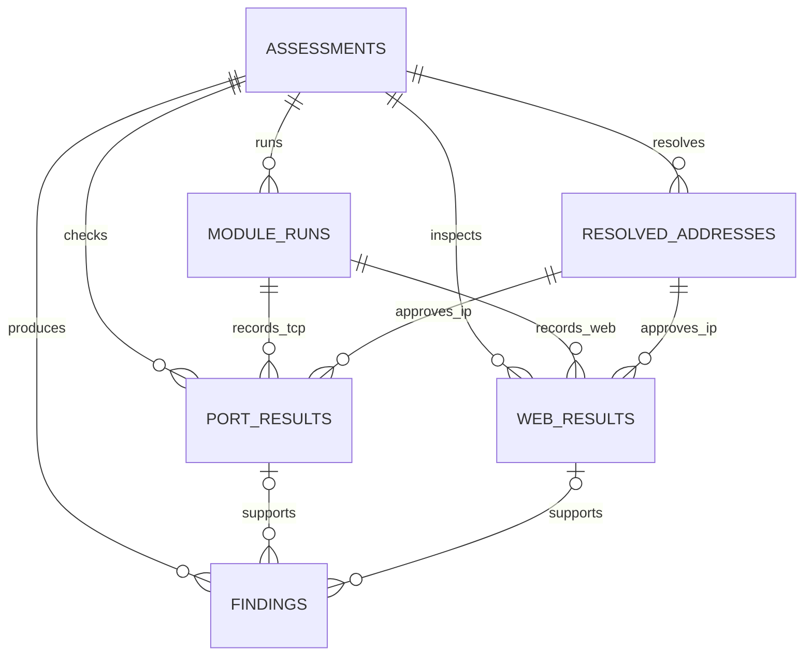

# System Architecture

## 1. Purpose and design principles

This document records the approved architecture and the implemented design for **ThreatLens — Network Discovery, Traffic Analysis and Security Assessment Platform.** The current implementation is restricted to configured loopback targets and ports.

The design follows these principles:

- **Project isolation:** source code, configuration, dependencies, database, reports, tests, and documentation belong only to this project. The tool does not read or modify SquadLink, PhishingGuard, or Zes AI Companion files, databases, Git settings, credentials, or environments.
- **Fail closed:** missing, ambiguous, or out-of-scope authorization prevents network connections.
- **Bounded assessment:** one explicitly approved target, a fixed list of approved TCP ports, conservative timeouts, sequential checks, no retries, and no exploitative probes.
- **Traceable results:** store observations and evidence separately from interpretation; distinguish unknown results from negative results.
- **Beginner-friendly modules:** each module has one clear responsibility and communicates through typed data models and explicit function inputs/outputs.
- **Data minimization:** do not collect credentials, raw cookie values, or unnecessary page content.

## 2. Complete project folder structure

```text
Cybersecurity-Project-3/
|-- README.md
|-- requirements.txt
|-- config/
|   |-- approved_targets.example.json
|   |-- app_settings.example.json
|   |-- approved_targets.json             # operator-created project-local config
|   `-- app_settings.json                 # operator-created project-local config
|-- data/
|   `-- cybersecurity_assessment.db        # created by the application at runtime
|-- reports/
|   `-- .gitkeep                            # optional; generated reports go here
|-- src/
|   `-- cyber_assessment/
|       |-- __init__.py
|       |-- __main__.py                     # python -m cyber_assessment
|       |-- cli.py                          # user input, confirmation, display
|       |-- config.py                       # project-local configuration loading
|       |-- models.py                       # assessment/result data structures
|       |-- errors.py                       # application-specific exceptions
|       |-- scope.py                        # validation, authorization, DNS pinning
|       |-- tcp_assessor.py                 # conservative TCP checks
|       |-- service_id.py                   # cautious service-name inference
|       |-- web_assessor.py                 # bounded HTTP/HTTPS checks
|       |-- risk.py                         # severity and confidence assignment
|       |-- database.py                     # SQLite schema and persistence
|       `-- reporting.py                    # JSON and escaped HTML reports
|-- tests/
|   |-- test_cli.py
|   |-- test_scope.py
|   |-- test_tcp_assessor.py
|   |-- test_service_id.py
|   |-- test_web_assessor.py
|   |-- test_risk.py
|   |-- test_database.py
|   `-- test_reporting.py
|-- documentation/
    |-- PROJECT_PROPOSAL.md
    |-- SYSTEM_ARCHITECTURE.md
    |-- RESEARCH_DOCUMENT.md
    |-- TECHNICAL_REPORT.md
    |-- USER_GUIDE.md
    |-- TEST_RESULTS.md
    `-- diagrams/
        |-- SYSTEM_ARCHITECTURE_DIAGRAM.md
        |-- APPLICATION_WORKFLOW_DIAGRAM.md
        `-- DATA_FLOW_DIAGRAM.md
`-- submission/
    |-- 01_Source_Code/
    |-- 02_Project_Documentation/
    |-- 03_Architecture_Diagrams/
    |-- 04_Test_Evidence/
    |-- 05_Assessment_Reports/
    `-- 06_Presentation/
```

`data/cybersecurity_assessment.db` is the only production database path. Configuration examples contain no credentials. Runtime configuration is read from this project's own `config/` directory, not from other projects or inherited secrets. The application creates the reports directory when it writes reports.

## 3. System architecture diagram

The component diagram is saved separately at [SYSTEM_ARCHITECTURE_DIAGRAM.md](./diagrams/SYSTEM_ARCHITECTURE_DIAGRAM.md).

At a high level, the command-line interface validates the allowlisted target, resolves and validates its approved addresses, then displays the exact scope for confirmation. Only after confirmation does it pass that same validated scope to the assessment workflow. TCP and web observations are normalized into data models, classified, persisted, and used to generate reports.

## 4. Application workflow diagram

The workflow diagram is saved at [APPLICATION_WORKFLOW_DIAGRAM.md](./diagrams/APPLICATION_WORKFLOW_DIAGRAM.md).

The key control-flow rule is that the CLI validates the target and resolves all hostname answers before displaying the confirmation summary. Any resolution failure or disallowed answer stops before confirmation. No TCP or HTTP/HTTPS assessment connection is attempted until the user confirms the displayed target, resolved addresses, methods, and ports. After confirmation, the existing validated scope is reused rather than resolving the initial target again. Each redirect is separately validated and pinned before it is followed.

## 5. Data flow diagram

The data flow diagram is saved at [DATA_FLOW_DIAGRAM.md](./diagrams/DATA_FLOW_DIAGRAM.md).

The tool receives target and scope configuration, produces bounded network observations, transforms them into findings, then persists and reports them. Target-controlled response data remains untrusted. Before storage, validate its type and structure, normalize it, enforce length limits, and redact sensitive values. This validation/normalization is not output encoding: `reporting.py` must apply context-specific HTML escaping when inserting stored values into HTML text, attributes, or URLs. Never treat storage sanitization as a substitute for output encoding.

## 6. Python modules and responsibilities

| Module | Responsibility | Main inputs and outputs |
|---|---|---|
| `__main__.py` | Provides the standard module entry point and calls the CLI. | Starts `cli.main()`; no assessment logic. |
| `cli.py` | Presents options, collects and validates the target, resolves the approved scope, displays the exact scope/ports/methods, obtains explicit confirmation, coordinates an assessment, and reports errors/results to the user. | Input strings and confirmation; calls the orchestrator with the already validated scope. |
| `config.py` | Loads and validates only project-local configuration, including allowlist entries, approved ports, timeouts, pacing, and output paths. | Reads `config/`; returns immutable settings. Invalid/missing settings stop an assessment. |
| `models.py` | Defines typed structures for `AssessmentScope`, `ResolvedAddress`, `PortResult`, `WebCheckResult`, `Finding`, and `AssessmentResult`. | Shared data contracts between modules; contains no network or database work. |
| `errors.py` | Defines narrow, meaningful errors such as `InvalidTargetError`, `ScopeDeniedError`, `ResolutionError`, `AssessmentCancelledError`, and `PersistenceError`. | Imported by modules that need to report expected failures explicitly. |
| `scope.py` | Canonicalizes and validates IP/hostname input; checks the configured allowlist; resolves hostnames before confirmation; validates every returned address; builds a pinned target for each connection; checks redirect destinations. | Raw target plus approved configuration; returns only a validated scope or a specific error. |
| `tcp_assessor.py` | Tests only approved TCP ports against pinned addresses using sequential, time-bounded connection attempts. It never resolves target hostnames itself. | Validated scope; returns one `PortResult` per attempted approved address/port. |
| `service_id.py` | Maps observed ports to likely conventional service names and records the basis/confidence. | Port results and web-response evidence; returns service labels; does not send arbitrary probes. |
| `web_assessor.py` | Sends limited HTTP/HTTPS requests only to approved, pinned destinations; preserves the original target hostname on the initial request and the validated redirect hostname on each subsequent hop for the HTTP `Host` header and TLS SNI/certificate verification. It never resolves arbitrary hostnames itself. | Validated scope; asks `scope.py` to validate each redirect and return a pinned per-hop scope; returns validated, normalized, size-bounded `WebCheckResult` data and evidence. |
| `risk.py` | Applies the qualitative criteria in Section 12 to observations and emits severity, confidence, rationale, and remediation guidance. | Port/web observations; returns `Finding` objects. |
| `database.py` | Creates the project database/schema, persists each assessment module's observations and run status independently, and retrieves records for reporting. | Validated typed results and module status/error data; uses only `data/cybersecurity_assessment.db`. |
| `reporting.py` | Serializes stored results to versioned JSON and HTML; applies context-specific HTML output encoding and omits secrets. | Retrieved assessment records; writes files only below `reports/` unless the user explicitly selects another project-local path. |

`cli.py` is the coordinator, not a place to put scanning logic. Modules return structured results or raise a specific error; they do not print directly. This separation makes the network behavior testable without running an interactive command.

## 7. Module communication

The normal call sequence is:

1. `__main__.py` starts `cli.py`.
2. The CLI loads project-local settings and allowlist rules, then validates the supplied target's syntax and exact allowlist match through `scope.py`.
3. The CLI selects the approved methods and ports, resolves the target, validates every resolved IP against the loopback and allowlist rules, and constructs an immutable `AssessmentScope`. A resolution failure, empty answer set, or any disallowed answer stops the operation before confirmation.
4. The `AssessmentScope` contains the original target, canonical target, approved resolved IP addresses, hostname-to-IP mapping, approved ports, and permitted methods. The CLI displays those values and the loopback/redirect restrictions and asks the user to type `yes`. Declining ends the operation before any TCP or HTTP/HTTPS assessment connection and before creating an assessment record.
5. After confirmation, the CLI passes the already validated scope to the assessment workflow; it does not resolve the initial target again. `database.py` creates the assessment record and pending module-run records.
6. `tcp_assessor.py` and, when requested, `web_assessor.py` receive only the validated scope and return observations with a module status and any error details. Neither assessor performs its own DNS lookup or accepts an arbitrary hostname. TCP connects only to IP addresses contained in the scope. Web requests connect only to a pinned approved IP while using the original hostname for the HTTP `Host` header and TLS SNI/certificate hostname verification.
7. Each redirect is independently checked by `scope.py`; only a redirect whose host, method, port, and resolved addresses are approved is followed, using its pinned per-hop scope.
8. `database.py` persists each module's observations and status/error in a separate transaction. A later module failure cannot roll back observations already committed by a successful module. If a module fails after producing observations, those observations and the module's partial/failed status are committed together.
9. `service_id.py` annotates available port observations. `risk.py` classifies available observations, and `database.py` persists the resulting findings without discarding earlier module results.
10. `database.py` sets the overall assessment status to `partial` when one module fails but another has successful observations; it sets `failed` when no applicable module produced usable observations.
11. `reporting.py` reads the saved results and per-module statuses and creates JSON/HTML output, including successful results alongside module errors.
12. The CLI displays a summary and locations of generated artifacts.

No module reaches around `scope.py` to resolve or connect to its own arbitrary target. Network assessor functions require an `AssessmentScope`, not an arbitrary hostname string. The scope carries the original target and the approved destination mapping so hostname-based HTTP behavior can be checked without allowing a second DNS resolution to redirect the connection elsewhere. That interface is a key safety boundary.

## 8. SQLite database design

The database path is fixed to **`data/cybersecurity_assessment.db`**, relative to the project root. It is not shared with any other project. `database.py` creates the directory and schema if needed, enables SQLite foreign-key enforcement on every connection, and uses parameterized SQL. Assessment metadata, each module's observations/status, findings, and final status are committed in bounded transactions so a failed TCP or web module cannot undo results already stored by another module.

### 8.1 Tables

#### `assessments`

One record for each confirmed assessment run.

| Column | Type | Constraints / purpose |
|---|---|---|
| `assessment_id` | `TEXT` | Primary key; UUID string. |
| `requested_target` | `TEXT` | User-entered target; stored with safe length limits. |
| `canonical_target` | `TEXT` | Normalized IP address or hostname. |
| `target_kind` | `TEXT` | `ip` or `hostname`. |
| `started_at` | `TEXT` | UTC ISO-8601 timestamp. |
| `finished_at` | `TEXT` | Nullable UTC ISO-8601 timestamp. |
| `status` | `TEXT` | `running`, `completed`, `partial`, `aborted`, or `failed`, constrained by `CHECK`. A confirmed assessment starts as `running`. |
| `confirmation_at` | `TEXT` | UTC timestamp proving the in-application confirmation step occurred; not proof of legal authority. |
| `scope_snapshot_json` | `TEXT` | Snapshot of approved ports and relevant allowlist rule identifiers; no secrets. |
| `tool_version` | `TEXT` | Version recorded for reproducibility. |

#### `module_runs`

One record for each planned assessment module (TCP and web) within an assessment. It records module state and failure details independently of the observations produced by other modules.

| Column | Type | Constraints / purpose |
|---|---|---|
| `module_run_id` | `INTEGER` | Primary key. |
| `assessment_id` | `TEXT` | Foreign key to `assessments.assessment_id`, `ON DELETE CASCADE`. |
| `module_name` | `TEXT` | `tcp_assessment` or `web_assessment`; constrained by `CHECK`. |
| `status` | `TEXT` | `pending`, `running`, `succeeded`, `partial`, `failed`, or `skipped`; constrained by `CHECK`. |
| `started_at` | `TEXT` | Nullable UTC ISO-8601 timestamp. |
| `finished_at` | `TEXT` | Nullable UTC ISO-8601 timestamp. |
| `error_code` | `TEXT` | Nullable bounded error category, such as `timeout`, `tls_error`, or `transport_error`. |
| `error_detail` | `TEXT` | Nullable, length-limited, normalized diagnostic detail with secrets and response content removed. |
| `observations_count` | `INTEGER` | Non-negative count of observations committed for this module. |
|  |  | Unique constraints on (`assessment_id`, `module_name`) and (`module_run_id`, `assessment_id`, `module_name`). |

#### `resolved_addresses`

The DNS/address decisions made for a confirmed assessment.

| Column | Type | Constraints / purpose |
|---|---|---|
| `resolved_address_id` | `INTEGER` | Primary key. |
| `assessment_id` | `TEXT` | Foreign key to `assessments.assessment_id`, `ON DELETE CASCADE`. |
| `hostname` | `TEXT` | Canonical hostname; nullable for direct IP targets. |
| `ip_address` | `TEXT` | Validated loopback address used for pinned connections. Each row represents an IP that passed the allowlist and loopback checks. |
| `address_family` | `INTEGER` | `4` or `6`. |
| `approved` | `INTEGER` | Must be `1`; constrained by `CHECK` to identify addresses accepted by the allowlist and loopback policy. |
| `approved_rule_id` | `TEXT` | Identifier of the matching local allowlist rule. |
| `resolved_at` | `TEXT` | UTC resolution timestamp. |
|  |  | Unique constraints on (`assessment_id`, `ip_address`) and (`assessment_id`, `ip_address`, `approved`) for result foreign keys. |

#### `port_results`

One outcome for each attempted address/port pair.

| Column | Type | Constraints / purpose |
|---|---|---|
| `port_result_id` | `INTEGER` | Primary key. |
| `assessment_id` | `TEXT` | Foreign key to `assessments.assessment_id`, `ON DELETE CASCADE`. |
| `module_run_id` | `INTEGER` | Part of a composite foreign key to the matching TCP `module_runs` row for this assessment. |
| `module_name` | `TEXT` | Fixed to `tcp_assessment` by a `CHECK`; participates in the composite module-run foreign key. |
| `ip_address` | `TEXT` | Pinned address that was checked. |
| `approved` | `INTEGER` | Must be `1`; participates in the composite foreign key to the approved resolved address. |
| `port` | `INTEGER` | TCP port constrained by a database `CHECK` to 1–65535; `database.py` also verifies it is in the assessment's approved list before insertion. |
| `protocol` | `TEXT` | `TCP`; constrained by `CHECK`. |
| `state` | `TEXT` | `open`, `closed`, or `filtered_unknown`; constrained by `CHECK`. |
| `service_name` | `TEXT` | Nullable, cautious likely-service label. |
| `identification_basis` | `TEXT` | For example, `well_known_port` or `http_response`; not a certainty claim. |
| `latency_ms` | `REAL` | Nullable measured connection time. |
| `error_code` | `TEXT` | Nullable bounded error category, not an unrestricted exception dump. |
| `observed_at` | `TEXT` | UTC timestamp. |
|  |  | Unique constraint on (`assessment_id`, `ip_address`, `port`, `protocol`). |
|  |  | Composite foreign keys: (`assessment_id`, `ip_address`, `approved`) references the approved `resolved_addresses` row for the same assessment; (`module_run_id`, `assessment_id`, `module_name`) references the matching TCP `module_runs` row. |

#### `web_results`

One record per attempted HTTP or HTTPS check.

| Column | Type | Constraints / purpose |
|---|---|---|
| `web_result_id` | `INTEGER` | Primary key. |
| `assessment_id` | `TEXT` | Foreign key to `assessments.assessment_id`, `ON DELETE CASCADE`. |
| `module_run_id` | `INTEGER` | Part of a composite foreign key to the matching web `module_runs` row for this assessment. |
| `module_name` | `TEXT` | Fixed to `web_assessment` by a `CHECK`; participates in the composite module-run foreign key. |
| `requested_scheme` | `TEXT` | `http` or `https`; constrained by `CHECK`. |
| `requested_host` | `TEXT` | Canonical approved hostname or IP. |
| `connected_ip` | `TEXT` | Pinned and approved destination address. |
| `approved` | `INTEGER` | Must be `1`; participates in the composite foreign key to the approved resolved address. |
| `http_status` | `INTEGER` | Nullable HTTP response status. |
| `redirect_chain_json` | `TEXT` | Validated/normalized status and approved destination origins; no query values or credentials. |
| `tls_status` | `TEXT` | `verified`, `failed`, `not_applicable`, or `not_checked`. |
| `headers_json` | `TEXT` | Allowlisted security-header observations only. |
| `cookie_attributes_json` | `TEXT` | Per-cookie attribute booleans/values; never raw cookie values. |
| `error_code` | `TEXT` | Nullable bounded failure category. |
| `observed_at` | `TEXT` | UTC timestamp. |
|  |  | Composite foreign keys: (`assessment_id`, `connected_ip`, `approved`) references the approved `resolved_addresses` row for the same assessment; (`module_run_id`, `assessment_id`, `module_name`) references the matching web `module_runs` row. |

#### `findings`

Assessment interpretations tied to their source observations.

| Column | Type | Constraints / purpose |
|---|---|---|
| `finding_id` | `INTEGER` | Primary key. |
| `assessment_id` | `TEXT` | Foreign key to `assessments.assessment_id`, `ON DELETE CASCADE`. |
| `port_result_id` | `INTEGER` | Nullable foreign key to `port_results.port_result_id`, `ON DELETE CASCADE`. |
| `web_result_id` | `INTEGER` | Nullable foreign key to `web_results.web_result_id`, `ON DELETE CASCADE`. |
| `severity` | `TEXT` | `informational`, `low`, `medium`, or `high`; constrained by `CHECK`. |
| `confidence` | `TEXT` | `low`, `medium`, or `high`; constrained by `CHECK`. |
| `category` | `TEXT` | Such as `network_exposure`, `transport`, `header`, or `cookie`. |
| `title` | `TEXT` | Short finding name. |
| `description` | `TEXT` | Plain-text explanation of the observation. |
| `evidence_json` | `TEXT` | Minimal validated, normalized, size-limited evidence with sensitive values redacted. |
| `recommendation` | `TEXT` | Proportionate defensive guidance. |
| `created_at` | `TEXT` | UTC timestamp. |
|  |  | `CHECK` prevents a finding from referencing both a port and a web result. Both may be null for an assessment-level note. |

`resolved_addresses` has unique keys on (`assessment_id`, `ip_address`) and (`assessment_id`, `ip_address`, `approved`); result rows use the latter composite foreign key and require `approved = 1`, binding each IP to an approved resolved address for the same assessment. The fixed `module_name` values and composite module-run foreign keys ensure TCP results cannot reference web runs and web results cannot reference TCP runs. Add indexes on `assessments.started_at`, `module_runs.assessment_id`, `port_results.assessment_id`, `port_results.module_run_id`, `web_results.assessment_id`, `web_results.module_run_id`, and `findings.assessment_id`. Evidence JSON is explanatory data; authoritative relationships are represented by foreign keys rather than embedded IDs alone.

To prevent a finding from accidentally linking a result from a different assessment, add unique keys on (`port_result_id`, `assessment_id`) and (`web_result_id`, `assessment_id`), then use matching composite foreign keys from `findings`. The `findings` check constraint permits at most one of `port_result_id` and `web_result_id` to be non-null; both may be null for an assessment-level note.

### 8.2 Relationships



## 9. Target allowlisting and authorization design

Allowlisting and authorization are separate controls:

- **Allowlisting** answers which destinations the tool is technically permitted to contact.
- **User authorization** is the operator's responsibility. The user must have permission from the target owner; a matching allowlist entry does not prove that permission exists.
- **Confirmation** ensures the operator sees the target and planned checks before network activity.

Proposed controls:

1. Load a project-local allowlist from `config/approved_targets.json`; provide only a safe example configuration in documentation or `config/approved_targets.example.json`. Do not read credentials or settings from sibling projects or unrelated environment variables.
2. Start with loopback entries only. Private, lab, or public addresses are not automatically considered authorized because of their address range; an operator must explicitly add the desired host/address and approved port list.
3. Normalize IPs using `ipaddress`. Normalize hostnames using lowercase IDNA form and remove a single trailing dot. Reject URL syntax where a hostname is expected, embedded credentials, whitespace tricks, zone identifiers unless explicitly supported, and malformed names.
4. Require hostname rules to specify allowed resolved IP addresses or explicitly approved CIDRs. Resolve the allowlisted hostname while constructing the scope, before asking for assessment confirmation, so the operator can review the exact resolved set. If any returned A/AAAA address is outside the configured range, reject the hostname before confirmation rather than filtering the result set. For the current implementation, enforce loopback-only addresses in code as well as configuration: private, lab, university, and public addresses are out of scope.
5. Include the original target, canonical target, approved resolved IP addresses, hostname-to-IP mapping, approved ports, and permitted assessment methods in the validated `AssessmentScope`. Pin every connection to an IP in that scope. For HTTP/HTTPS, preserve the original hostname in the HTTP `Host` header and TLS SNI/certificate hostname check while connecting to the pinned approved IP. If the transport cannot guarantee pinning, refuse hostname-based web assessment rather than falling back to a normal DNS-resolving request.
6. Do not use environment-configured HTTP proxies (`trust_env=False`) because a proxy can change where a request is actually sent.
7. Disable automatic redirects. Parse each `Location`, allow only HTTP/HTTPS schemes with no embedded credentials, validate its hostname and resolved addresses against the allowlist, pin the next connection, and enforce a small hop limit (proposed maximum: 3). If any hop is out of scope, stop and record a blocked redirect. Never forward credentials; the tool does not accept or send authentication credentials.
8. Display the original/canonical target, all resolved addresses, selected tests, approved ports, and relevant restrictions and require an affirmative confirmation. DNS/scope validation occurs before this prompt; cancellation creates no TCP or HTTP/HTTPS assessment checks or assessment record.
9. Fail closed on DNS errors, inconsistent DNS answers, unsupported address families, missing configuration, or an unexpected redirect. Do not infer authorization merely because a target is localhost or uses a private address.

The hostname pinning transport is a security-critical implementation detail and must be validated in Phase 5 tests (including simulated DNS changes) before hostname scanning is considered complete.

The initial implementation limitation is localhost/loopback-only assessment. Allowlist entries, hostname mappings, and resolved-address rows cannot widen the application to a non-loopback address.

## 10. TCP port assessment algorithm

1. Accept only the `AssessmentScope` produced by `scope.py`; reject direct arbitrary-host input at this module boundary. Select destinations only from its approved resolved IP addresses and never resolve a hostname independently.
2. Verify each requested port is an integer in 1–65535 and is included in the fixed allowlist. Remove duplicates and process in deterministic order.
3. Use only TCP stream sockets. For every pinned destination and approved port, attempt one connection sequentially, with a proposed connect timeout of 1.5 seconds and at least 250 ms between attempts. Do not retry or create concurrent workers.
4. Classify results:
   - **Open:** the TCP connection completes successfully.
   - **Closed:** the destination explicitly refuses the connection (for example, connection refused).
   - **Filtered/unknown:** timeout, network/host unreachable, administrative filtering, or another ambiguous error prevents a conclusion. A timeout is not “closed.”
5. Record a sanitized error category and elapsed time. Close the socket in all cases.
6. Continue to the next approved port after a port-specific result. If the scope becomes invalid or pinned-address enforcement fails, stop the assessment.

The 1.5-second timeout and 250-ms pacing are proposed conservative defaults for review; they are configuration values with safe upper/lower bounds, not user-overridable unrestricted scan settings.

## 11. Service identification approach

Service identification is deliberately conservative:

- First, associate an open port with a conventional service name from a small local mapping. Label this as **likely by port**, not verified.
- For HTTP/HTTPS checks performed by the web module, use the actual HTTP response as stronger protocol evidence.
- Do not send arbitrary payloads, attempt authentication, probe for vulnerabilities, or request banners from every service.
- Do not infer product versions or vulnerabilities from port numbers alone.
- Store the identification basis and confidence. If evidence is insufficient, report `unknown` rather than guessing.

## 12. HTTP/HTTPS security assessment approach

1. Assess only explicitly permitted HTTP/HTTPS methods and approved web ports in the validated `AssessmentScope`.
2. Use Requests with explicit connect/read timeouts, TLS certificate verification enabled, redirects disabled, no credentials, no cookies reused between checks, and environment proxy discovery disabled.
3. Use only a pinned approved IP from the validated scope; do not perform independent or arbitrary hostname resolution. For the initial request, preserve the original target hostname for the HTTP `Host` header, TLS SNI, and certificate hostname verification. For a redirect, use that redirect's validated hostname for those checks while connecting only to its pinned approved IP. Do not disable certificate validation to make a check pass.
4. Use a small redirect limit (proposed maximum: 3). Validate every redirect before following it; record and stop at an out-of-scope destination. Record HTTP-to-HTTPS behavior separately from whether the HTTPS certificate verifies.
5. Prefer a single bounded GET request when headers/cookies are needed. Stream the response and cap the bytes read (proposed maximum: 256 KiB) if HTML must be parsed; close responses promptly. Do not crawl links, submit forms, or download unbounded bodies.
6. Inspect response status, redirect location (sanitized), TLS result, and selected headers: `Strict-Transport-Security` (HTTPS only), `Content-Security-Policy`, `X-Content-Type-Options`, `X-Frame-Options` or CSP `frame-ancestors`, and `Referrer-Policy`. A missing header is an observation whose severity depends on context.
7. Parse each `Set-Cookie` header separately and record only the cookie name if needed plus `Secure`, `HttpOnly`, and `SameSite` observations. Never persist cookie values. Do not treat attributes as proof of overall session security.
8. Use Beautiful Soup only when bounded HTML parsing is required; it is not needed to inspect HTTP headers or cookies.
9. Report failures explicitly: timeout, out-of-scope redirect, DNS rejection, TLS validation failure, or unsupported response. Do not turn a failed request into a “secure” result.

## 13. Risk classification methodology

Severity describes the observed condition's potential defensive significance; confidence describes how directly the tool observed it. They are separate fields. Categories are project-specific qualitative labels and are not CVSS scores.

| Severity | Criteria | Examples in this tool's limited scope |
|---|---|---|
| **Informational** | Observation only; no weakness is established by the evidence. Useful for inventory or context. | An approved port is open; a service is likely based on its port; an HTTP endpoint redirects to HTTPS; a header is present. |
| **Low** | A narrow hardening opportunity with limited demonstrated impact and no evidence of sensitive data exposure. | A recommended defense-in-depth header is absent on a page where context indicates only limited impact; a non-sensitive cookie lacks an optional attribute. |
| **Medium** | A specific, reproducible configuration weakness is directly observed in a relevant context and could create meaningful risk, but major impact or exploitability is not established by this tool. | A session-related cookie demonstrably lacks an important attribute in the relevant transport context; HTTPS is available but a related HTTP endpoint does not redirect, increasing the chance of plaintext access. |
| **High** | Direct, high-confidence evidence shows a configuration that could expose sensitive information or materially undermine protection under a common condition. Do not assign High based only on an open port, a missing header, a guessed service, or a timeout. | Reserved for a directly confirmed sensitive-data/transport exposure supported by approved test context. Current unauthenticated checks may not have enough evidence to assign High automatically; such cases should remain Medium or be marked for authorized manual review. |

Every finding records: severity, confidence, observation, evidence, rationale, and a proportionate recommendation. A missing header alone is not automatically Medium or High. The tool must prefer a lower severity or an explicit “needs review” note when application context is unknown.

Confidence is recorded separately: **High** means the relevant behavior was directly and consistently observed; **Medium** means the evidence supports the observation but context or network behavior limits certainty; **Low** means the result is an indirect inference, such as a service label based only on its port number.

## 14. JSON and HTML report structure

### JSON

Reports are UTF-8 JSON with a schema version. Suggested shape:

```json
{
  "schema_version": "1.0",
  "assessment": {
    "assessment_id": "uuid",
    "target": "approved-target",
    "started_at": "UTC ISO-8601 timestamp",
    "finished_at": "UTC ISO-8601 timestamp",
    "status": "partial",
    "scope": {
      "approved_ports": [80, 443],
      "resolved_addresses": ["validated-addresses-only"]
    }
  },
  "module_runs": [
    {
      "module": "tcp_assessment",
      "status": "succeeded",
      "error_code": null,
      "error_detail": null,
      "observations_count": 4
    },
    {
      "module": "web_assessment",
      "status": "failed",
      "error_code": "tls_error",
      "error_detail": "TLS verification failed",
      "observations_count": 0
    }
  ],
  "port_results": [
    {
      "address": "validated-address",
      "port": 443,
      "protocol": "TCP",
      "state": "open",
      "likely_service": "https",
      "identification_basis": "well_known_port"
    }
  ],
  "web_results": [],
  "findings": [
    {
      "severity": "informational",
      "confidence": "medium",
      "title": "Example observation",
      "evidence": {},
      "recommendation": "Review in the context of the application."
    }
  ],
  "limitations": [
    "Results reflect only the approved checks and assessment time."
  ]
}
```

Use the actual validated values in generated reports; the example is illustrative, not a claim that an assessment was run. Do not include raw cookie values, credentials, full response bodies, or unredacted query parameters.

### HTML

The HTML report presents:

1. Project name, report schema/version, assessment ID, timestamp, and completion status.
2. Target and scope summary, including approved ports and resolved addresses.
3. Each module's status and any bounded error code/detail.
4. TCP results grouped by destination with distinct **Open**, **Closed**, and **Filtered/Unknown** labels.
5. Web/TLS observations, redirect decisions, selected headers, and cookie-attribute summaries.
6. Findings grouped by severity, with confidence, evidence, rationale, and recommendations.
7. Limitations and an explicit authorized-use notice.

HTML is generated from structured records, not by inserting response content as markup. Validate and normalize observations before storage, but do not HTML-escape values at storage time or assume that validation makes them safe to render. At report generation, apply context-specific output encoding: HTML text escaping for text nodes, attribute escaping for attribute values, and safe URL validation/encoding for links. Do not interpolate untrusted values into script, style, or raw HTML contexts. JSON reports use a JSON serializer; HTML escaping is not a substitute for JSON serialization. Omit sensitive values and avoid external scripts/resources. A report failure must be surfaced to the user and must not corrupt an already written report; write to a temporary file then replace the final file atomically.

## 15. Error handling strategy

- Validate configuration and target input before any network operation; invalid settings stop immediately with a clear message.
- Use narrow exception handling at module boundaries. Convert expected socket, DNS, HTTP, TLS, and SQLite failures into typed result/error categories; retain enough sanitized detail for diagnosis.
- Distinguish a port refusal (`closed`) from timeout/unreachable (`filtered_unknown`).
- Treat DNS failures, out-of-scope resolutions, failed pinning, unapproved redirects, and missing confirmation as hard scope failures; make no connection to the rejected destination.
- Validate and normalize observations before persistence: enforce expected types and field limits, normalize addresses/hostnames and structured values, redact cookie values/credentials, and record bounded error categories. This protects the stored data but is not HTML output encoding.
- Record a `module_runs` row for each planned module, including `status`, timestamps, and a bounded error code/detail. Keep successful module observations even if TCP or HTTP/HTTPS fails. Persist each module's observations and its status/error in its own transaction; a failure in one module must not roll back another module's committed observations. Mark the overall assessment `partial` when one module fails while another provides usable observations.
- Never silently return an empty success-shaped result. Unexpected programming errors are surfaced to the CLI and logged with a concise traceback only in a project-local diagnostic log; do not dump secrets or remote response bodies.
- Use SQLite transactions and foreign-key enforcement. Roll back only the failed module's uncommitted write, preserve earlier committed module data, and raise a persistence error if saving fails.
- Do not store credentials, cookie values, or unbounded response content. Apply context-specific output encoding only when generating the relevant report format.

## 16. Testing strategy

All tests must be local and deterministic; unit tests must not make public network connections.

| Area | Test method and essential cases |
|---|---|
| Target input and allowlist | Valid/invalid IPv4, IPv6, and hostname; canonicalization; exact allowlist match; unapproved target denied; private/public address not automatically authorized. |
| DNS and hostname pinning | Approved A/AAAA answers accepted; any out-of-scope answer rejects the whole target; changing answer between validation and connect cannot change the pinned destination; resolution failure fails closed. |
| Confirmation | Declining confirmation makes zero connection calls and creates no assessment record. |
| TCP states | Local test server gives `open`; unused local port gives `closed` where the OS returns connection refusal; injected timeout/unreachable errors produce `filtered_unknown`; verify approved ports only, one attempt, and configured pacing/timeout. |
| Service identification | Known port is labeled “likely by port”; unusual port remains unknown; no unsupported version claim is made. |
| HTTP and HTTPS | Local HTTP test server returns headers/cookies; verify the request timeout, bounded response, TLS validation behavior, and no credentials. |
| Redirect scope | HTTP-to-HTTPS approved redirect can be checked; cross-host redirect outside allowlist is not followed; redirect to an unapproved IP, downgrade, malformed URL, or excessive hops is blocked. |
| Headers and cookies | Present/missing headers produce observations; HSTS is assessed only for HTTPS; multiple `Set-Cookie` headers are parsed separately; raw values are absent from stored output. |
| Risk | Representative observations map to each severity and confidence; an open port or missing header alone cannot become High. |
| Database | Schema creation, insert/read, foreign keys, constraints, module status/error persistence, transaction rollback, and fixed project-specific database path. Verify that successful TCP results remain after a web-module failure and vice versa. |
| Reports | JSON schema/required keys, distinction between storage validation and context-specific HTML encoding, secret redaction, partial-result/module-error reporting, correct port-state labels, and atomic write failure handling. |
| Project isolation | Verify runtime paths resolve under this workspace and database/report paths do not point to sibling projects. |

Use Python's standard-library `unittest` for unit and integration tests. Network integration tests should bind only to loopback or an isolated lab. Mock or inject the resolver/transport for DNS rebinding and redirect tests; never create a test that probes a public target.

## 17. Phase boundary

This document and the three diagram files define the proposed design. No Python application module, database file, configuration file, dependency installation, or scan has been created or performed as part of Phase 3. Phase 4 implementation should begin only after review and approval of this architecture.
