# Data Flow Diagram

```mermaid
flowchart LR
    Operator[Operator]
    ScopeConfig[(Project-local allowlist<br/>and settings)]
    Input[Target + selected scope]
    Validate[Validate target, allowlist, methods, and ports]
    DNS[Resolve and verify every address]
    Pinned[Validated AssessmentScope]
    Review[Display complete scope]
    Confirm{Operator types yes?}
    TCP[Bounded TCP connection checks]
    HTTP[Bounded HTTP/HTTPS requests]
    RawObs[Validate, normalize, bound, and redact observations]
    Classify[Service inference + risk classification]
    DB[(Project SQLite database)]
    JSON[JSON report]
    Encode[Context-specific HTML escaping]
    HTML[HTML report]
    Output[Operator review]

    Operator --> Input
    ScopeConfig --> Validate
    Input --> Validate
    Validate --> DNS
    Validate -->|invalid / denied| Denied[Stop; no assessment connection]
    DNS -->|all answers approved| Pinned
    DNS -->|any answer out of scope| Denied
    Pinned --> Review
    Review --> Confirm
    Confirm -->|yes| TCP
    Confirm -->|yes| HTTP
    Confirm -->|no| Cancel[Stop; no assessment connection or database record]
    TCP --> RawObs
    HTTP --> RawObs
    RawObs --> Classify
    Classify --> DB
    DB --> JSON
    DB --> Encode
    Encode --> HTML
    JSON --> Output
    HTML --> Output
    Output --> Operator
```

**Trust boundaries:** User input and remote responses are untrusted. Scope validation gates network access, and confirmation gates assessment connections. Validate, normalize, bound, and redact observations before storage; this is not output encoding. Apply context-specific HTML escaping when rendering stored values. Cookie values, credentials, and full response bodies are not report data. Module status and observations are persisted independently so one module's failure does not erase another module's results.
