# System Architecture Diagram

```mermaid
flowchart LR
    User[User / Operator]
    CLI[CLI and orchestration]
    Config[Project-local configuration]
    Scope[Scope control<br/>validate, allowlist, resolve, pin]
    Confirm[Display exact scope<br/>and require yes]
    TCP[TCP assessor]
    Service[Service identification]
    Web[HTTP / HTTPS assessor]
    Models[Typed assessment models]
    Risk[Risk classification]
    DB[(SQLite<br/>data/cybersecurity_assessment.db)]
    Report[JSON / escaped HTML reporting]
    Files[reports/]

    User -->|target and options| CLI
    Config --> CLI
    Config --> Scope
    CLI -->|target + selected checks| Scope
    Scope -->|validated pinned scope for review| CLI
    CLI --> Confirm
    Scope -->|same validated scope| Confirm
    User -->|affirmative confirmation| Confirm
    Confirm -->|confirmed scope only| TCP
    Confirm -->|confirmed scope only| Web
    TCP --> Models
    Web --> Models
    Models --> Service
    Service --> Risk
    Models --> Risk
    Risk --> DB
    Models --> DB
    DB --> Report
    Report --> Files
    Report --> CLI
    CLI --> User
```

**Boundary:** Scope validation and resolution happen before the confirmation prompt so the complete destination set can be displayed. No assessment connection occurs until affirmative confirmation. Only `scope` issues a validated target scope; assessors must not resolve or connect to arbitrary input on their own.
